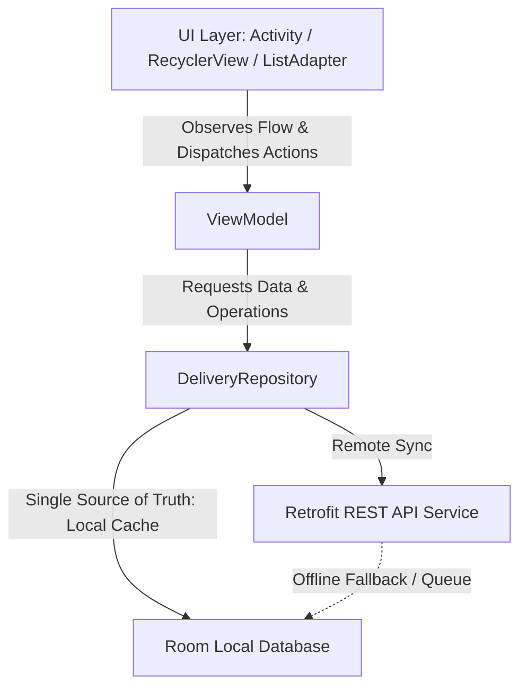

# Architecture Blueprint - FleetTrackPro

## 1. Overview
FleetTrackPro is an offline-first courier management Android application designed for Cirebon logistics operations. It adheres to the **Model-View-ViewModel (MVVM)** architectural pattern and clean architecture principles.

## 2. Architectural Layers

### Data Flow & Single Source of Truth
1. **Local Room Database** serves as the **Single Source of Truth**. The UI never reads directly from the network; it observes reactive `Flow<List<DeliveryOrderEntity>>` emitted by Room.
2. **Repository (`DeliveryRepository`)**:
   - Manages coordination between local cache and remote API.
   - On status update (e.g. marking order as delivered), updates Room immediately (`DELIVERED`, `isSynced = false`) and logs it to `sync_queue` for instant UI feedback.
   - Attempts server synchronization; if network is available and successful, clears queue item and sets `isSynced = true`. If offline/failed, retains queue item for retry on next refresh.
   - On swipe-to-refresh, fetches remote manifest, upserts into local Room, and flushes pending sync queue.

## 3. Tech Stack & Decisions
- **Language**: Kotlin 100%, JVM target 17.
- **UI Framework**: XML Views with ViewBinding (No Jetpack Compose).
- **Persistence**: Room Database (SQLite with KSP compiler).
- **Networking**: Retrofit 3 + Gson Converter + OkHttp Logging Interceptor.
- **Concurrency**: Kotlin Coroutines & Flow (`viewModelScope`, Dispatchers.IO).
- **Logging**: Timber (DebugTree on debug builds only).
